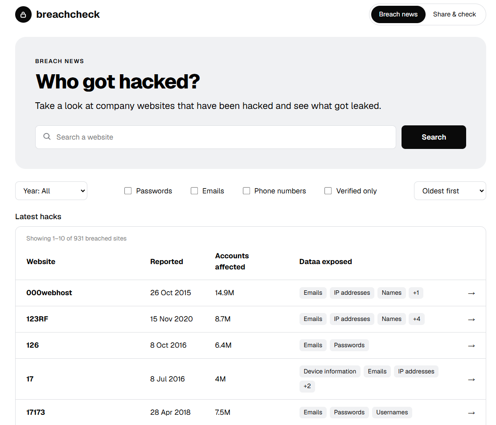
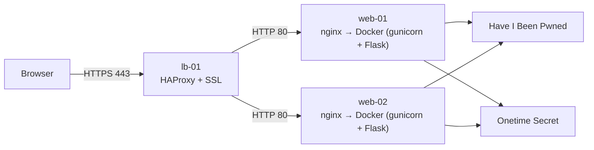

# breachcheck

Find out which websites have been hacked before you share your information with them, and share passwords safely with a link that expires after one view or a set time.

**Live:** https://www.ishema.app

**Demo video:** https://www.loom.com/share/1d58ce3fae964c67ad74fcd89c2267c0

## Screenshots

**Breach news**



**Share & check**


---

## Why this app

Websites and companies get hacked all the time, and hackers steal their users' data. You should be aware before sharing any information.

People also send passwords in chats, where they stay forever.

breachcheck helps with both.

---

## Features

**Breach news**
- See a list of real websites that got hacked.
- For each website, see what kind of data was leaked, such as passwords or phone numbers.
- Search for a website, or sort the list.

**Share & check**
- Type a password to see if hackers already have it, and if it is strong.
- Turn it into a secret link if you want to share it.
- The link works once, then it is gone.

---

## APIs used

| API | Used for | Docs |
|---|---|---|
| Have I Been Pwned: Breaches | The breach list | [haveibeenpwned.com/API/v3](https://haveibeenpwned.com/API/v3#AllBreaches) |
| Have I Been Pwned: Pwned Passwords | Leak check (k-anonymity range search) | [haveibeenpwned.com/API/v3](https://haveibeenpwned.com/API/v3#PwnedPasswords) |
| Onetime Secret v1 | Create, reveal and delete one-time links | [docs.onetimesecret.com](https://docs.onetimesecret.com/docs/rest-api/v1) |

The breach list skips entries that are not a hacked website: spam lists, fabricated, sensitive (adult) and malware or stealer-log entries.

---

## How it works



The browser only talks to our server. The server calls the APIs, so the Onetime Secret key never reaches the browser.

### Routes

| Method | Route | What it does |
|---|---|---|
| GET | `/` | Main page with both tabs |
| GET | `/secret/<key>` | Same page, opens the reveal card |
| GET | `/health` | `{"status": "ok"}` for the load balancer |
| GET | `/api/breaches` | Breach list (cached 6 hours) |
| GET | `/api/password/<prefix>` | Leaked hashes starting with a 5-character prefix |
| POST | `/api/share` | Create a one-time link |
| POST | `/api/reveal/<key>` | Open a secret (deleted right after) |
| POST | `/api/burn/<key>` | Delete a link before it is opened |

---

## Security and privacy

| What | How |
|---|---|
| Your password in the leak check | Hashed with SHA-1 **in the browser**. Only the first 5 characters of the hash are sent, so nobody, including us, sees the password |
| Shared secrets | Stored by Onetime Secret, not by us. Deleted after one view or when they expire |
| API key | Only in `.env` on the servers. Never in the code, the repo or the browser |
| Headers | `Content-Security-Policy`, `X-Frame-Options: DENY`, `X-Content-Type-Options: nosniff`, `Referrer-Policy: no-referrer` |
| Caching | `/secret/...` and `/api/...` send `Cache-Control: no-store` |
| Input checks | Secret length, expiry range and link keys are checked on the server |
| HTTPS | Let's Encrypt certificate on lb-01, TLS 1.2+, `http://` redirected to `https://` |
| XSS | Text from the APIs is escaped before it goes on the page |

---

## Run it locally

You need Python 3.10+ and a free [Onetime Secret](https://onetimesecret.com) account (only for sharing).

```bash
git clone https://github.com/nissi15/breach-checker-summative.git
cd breach-checker-summative
python -m venv .venv
.venv\Scripts\activate          # Windows  (Mac/Linux: source .venv/bin/activate)
pip install -r requirements.txt
```

Create a file called `.env` in the project folder:

```
OTS_USERNAME=your-onetimesecret-email
OTS_API_KEY=your-onetimesecret-api-key
OTS_REGION=us
SERVER_NAME=local
```

Then start the app and open http://127.0.0.1:5000:

```bash
python app.py
```

### Environment variables

| Variable | Meaning | Default |
|---|---|---|
| `OTS_USERNAME` | Onetime Secret account email | required for sharing |
| `OTS_API_KEY` | Onetime Secret API key | required for sharing |
| `OTS_REGION` | `us` or `eu`, where your account lives | `us` |
| `SERVER_NAME` | Name shown in the footer and the `X-Served-By` header | `local` |

### With Docker

```bash
docker compose up --build
```

### Tests

```bash
python -m pytest -v
```

14 tests cover the pages, security headers, input checks, caching and API failures. All external APIs are faked, so tests need no internet or key.

---

## Deployment

| Server | Role |
|---|---|
| `7301-lb-01` | HAProxy: HTTPS, http → https, round robin, `/health` checks |
| `7301-web-01` | nginx (port 80) → Docker container (gunicorn, port 5000) |
| `7301-web-02` | Same as web-01 |

### 1. Web servers (run on web-01, then web-02)

```bash
ssh ubuntu@WEB01_IP
sudo apt-get install -y git
git clone https://github.com/nissi15/breach-checker-summative.git
cd breach-checker-summative
sudo bash deploy/setup_web_server
nano .env                                   # add OTS_USERNAME and OTS_API_KEY
sudo docker compose up -d --force-recreate
curl localhost/health                       # {"status":"ok"}
```

`setup_web_server` installs Docker, nginx and git, creates `.env` with `SERVER_NAME` set to the server's hostname and empty keys, starts the container and points nginx at it.

### 2. Load balancer (run on lb-01)

```bash
ssh ubuntu@LB01_IP
sudo apt-get install -y git
git clone https://github.com/nissi15/breach-checker-summative.git
sudo bash breach-checker-summative/deploy/setup_load_balancer WEB01_IP WEB02_IP
```

The script sets up HAProxy so that it:

- uses HTTPS and sends `http://` visitors to `https://`
- sends visitors to web-01, then web-02, then web-01 again (round robin)
- checks `/health` on each server every 5 seconds, and stops sending visitors to a server that is down

It backs up the old HAProxy settings and checks the new ones before restarting. If they are wrong, the backup goes back. The SSL certificate must already be at `/etc/haproxy/certs/www.pem`.

### 3. CI/CD

`.github/workflows/deploy.yml` runs on every push to `main`:

1. **test:** installs the libraries, runs pytest and builds the Docker image.
2. **deploy:** only if tests pass. Connects to web-01, then web-02, runs `git pull` and `docker compose up -d --build`. One server stays online while the other updates.

Repo secrets needed: `WEB01_HOST`, `WEB02_HOST`, `SSH_PRIVATE_KEY`.

---

## Challenges

| Challenge | Solution |
|---|---|
| The breach list was full of spam lists and fake entries | Skip entries flagged as spam list, fabricated, sensitive, malware or stealer log |
| Checking a password without sending it | k-anonymity: hash in the browser, send only 5 characters of the hash |
| Docker image not appearing after build on Windows | Docker Desktop's builder needed `docker build --load` |

---

## Project structure

```
app.py                      Flask app: pages, API routes, security headers
templates/index.html        The page (both tabs and the reveal card)
static/style.css            Styles
static/breach.js            Breach news tab
static/script.js            Tabs, Share & check, leak check, reveal page
static/images/              Icons and README screenshots
tests/test_app.py           pytest tests
Dockerfile                  Container with gunicorn (2 workers)
docker-compose.yml          Runs the container with .env
deploy/setup_web_server     Sets up web-01 and web-02
deploy/setup_load_balancer  Sets up lb-01
.github/workflows/deploy.yml  CI/CD
```

---

## Credits

- Breach and password data: [Have I Been Pwned](https://haveibeenpwned.com) by Troy Hunt, licensed under [CC BY 4.0](https://creativecommons.org/licenses/by/4.0/)
- One-time links: [Onetime Secret](https://onetimesecret.com)
- Font: [Geist](https://vercel.com/font) via Google Fonts
